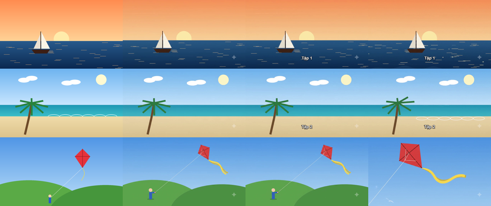
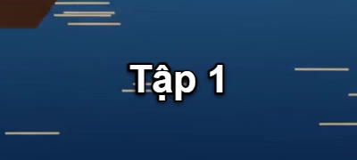

# Chạy thật — 3 dòng (Task 7)

Ngày 08/10/2026, Claude Code. Đã dùng đúng **3 lượt Veo**: bấm Bắt đầu đúng một lần, maxRetries 0, không thử lại.

## Thiết lập
- Người dùng đã Reload extension sau repair `3e27fa8`. App báo **Extension đã kết nối v1.1.10.0**, ID `bedjklgfehfcmlaldafbbdplgblpdpch`
  (TOFU giữ nguyên), FFmpeg 8.1.1 có cả ffprobe.
- Dự án scratch `.superpowers/sdd/2026-10-08-claude-code-finish-video-tool/live-run/` (git-ignore):
  - 3 ảnh vẽ 1280×720: `01_thuyen-buom.png`, `02_bai-bien.png`, `03_dieu-giay.png`.
  - Prompt chung "camera slowly pushes in, gentle natural motion" cộng prompt riêng từng dòng.
  - Text: dòng 1 "Tập 1", dòng 2 "Tập 2", dòng 3 trống.
  - Nhạc `music/nhac-thu.mp3` ở chế độ random, nhạc 25%, âm gốc 100%, fade 1 s / 1.5 s.
  - Image-to-video, 16:9, 720p, 3 luồng, maxRetries 0.
- Không dùng `live-fixture` có sẵn vì ảnh test màu không cho kiểm được khung đầu hay chuyển động. Fixture cũ vẫn giữ nguyên.

## Kết quả
App đạt **3/3 xong** (Xong + nút Xem), `running=false`. Tất cả 3 dòng cùng job `j1791477130943-1`.

| Dòng | Ảnh | Raw | Output | ffprobe |
|---|---|---|---|---|
| 1 | 01_thuyen-buom.png | `_1click/raw/001.mp4` | `Output/001_01_thuyen-buom.mp4` | h264 1280×720 24fps + aac, 10.005 s |
| 2 | 02_bai-bien.png | `_1click/raw/002.mp4` | `Output/002_02_bai-bien.mp4` | 1280×720 + audio, 10.005 s |
| 3 | 03_dieu-giay.png | `_1click/raw/003.mp4` | `Output/003_03_dieu-giay.mp4` | 1280×720 + audio, 10.005 s |

- **Thứ tự và ghép đúng ảnh**: thứ tự khớp, mỗi output là đúng cảnh của ảnh nguồn.
  - SSIM giữa ảnh nguồn và khung đầu raw: 0.917 / 0.954 / 0.934.
  - SSIM giữa raw và output: 0.992 / 0.990 / 1.000. Dòng 3 không có text nên không có overlay.
- **Text**: "Tập 1" và "Tập 2" hiện suốt video ở y = 0.85, đủ dấu tiếng Việt, có viền và bóng. Dòng 3 không có chữ.
  Thư mục overlays chỉ có `001.png` và `002.png`.
- **Âm thanh**: output giữ âm gốc của Veo và có thêm nhạc.
  - Đem output trừ đi âm raw thì phần còn lại có mean −37.4 dB ở cả 3 dòng.
  - Nhạc gốc có mean −21.5 dB; nhân 0.25 ra khoảng −33.5 dB, cộng thêm fade nên khớp.
  - Mức âm tổng: raw → output là −25.8 → −25.5, −35.0 → −33.1, −29.8 → −29.1 dB.
- **Chuyển động**: khung ở giây 7 khác khung đầu: camera đẩy vào, diều bay lên, lá dừa đung đưa.
- Không có file mp4 nào lọt vào thư mục Downloads; video đi thẳng vào `_1click/raw`.

## Quan sát (không phải lỗi của tool)
- Veo không giữ khung đầu y hệt ảnh nguồn. Bố cục giữ nguyên nhưng chi tiết được vẽ lại: dòng 3, diều đổi góc và đuôi dài hơn; dòng 2, các vệt sóng trắng mất ở khung đầu.
- Veo/Vids đóng dấu ✦ ở góc dưới phải mỗi video.

## Sự cố trong lúc chạy (chỉ ở chế độ dev)
- Lúc tải video 1, Vite dev server dừng với lỗi `EBUSY ... live-run\_1click\raw\.oneclick-1-4-001.mp4`.
  - Nguyên nhân: Vite theo dõi cả `.superpowers/`, nơi app đang ghi file tạm. `cargo tauri dev` vì thế thoát với mã 1.
  - Process app (PID 3208) vẫn chạy và hoàn tất cả 3 dòng, không gửi lại job nào.
- Đã sửa: `vite.config.js` bỏ qua thêm `**/.superpowers/**`. Bản cài không có Vite nên không bị.

## Kết luận
**Chạy thật đạt** với 3 dòng: tạo video, tải về đúng thứ tự, đặt text riêng từng dòng, trộn nhạc vào âm gốc, xuất mỗi video một file.
